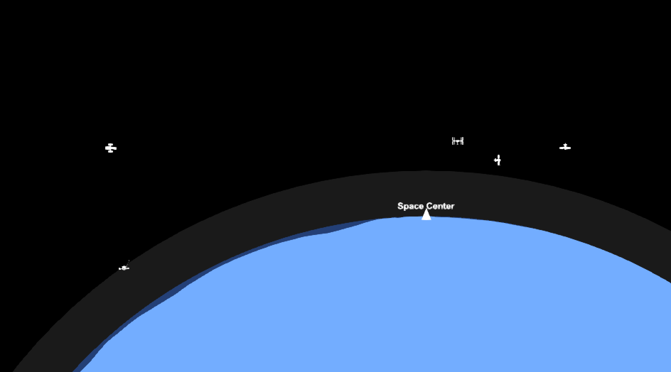
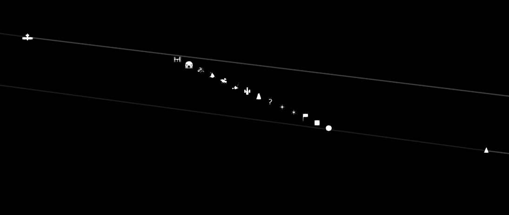
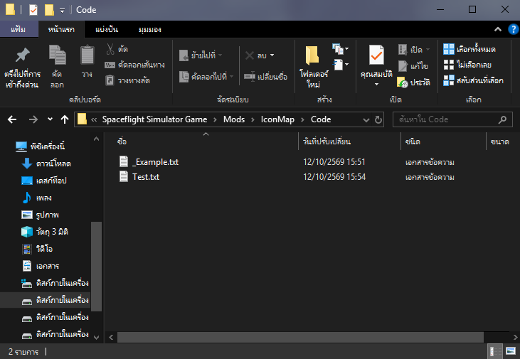
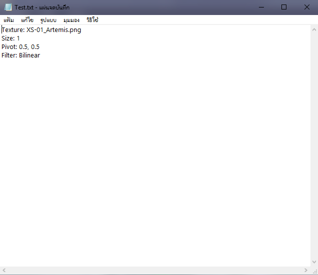

# </img> Icon Map

A code mod for [Spaceflight Simulator](https://store.steampowered.com/app/1718870/) (SFS) that replaces the default triangular rocket icons on the map with custom sprites

## Screenshots



---

## 1. About the mod

Icon Map changes how rockets look on the map. Instead of the same white triangle for every vehicle, you get distinct icons — satellites, stations, landers, flags, and more

**Includes 17 built-in icons**, for example:
- Satellite, Space Station, Rover, Probe, Hubble  
- Lander, Debris, Base, Flag, Question Mark  
- Circle, Square, Voyager  
- Octagon Star, Hexagon Star, Square Star  

Icons stay after staging and separation. If you name the rocket, the chosen icon can be remembered after restarting the game


---

## 2. How it works & how to use

1. Open the **map**  
2. **Click** the rocket you want to change  
3. Press **G** to cycle icons  

You can change the key in **Settings** anytime

That’s it — each press of the key moves to the next icon for the selected rocket

---

## 3. Custom icons

You can add your own icons without rebuilding the mod

After install, the mod folder looks like this:

```text
Mods/IconMap/
  IconMap.dll
  Code/
  Texture/
```
Simply place the PNG or JPG images and create a text file that defines the icon's appearance

</img>
</img>


# Authorship & Credits

* </img> **Luna Tomato**
  * [GitHub Profile](https://github.com/tomato9946) | [YouTube Channel](https://www.youtube.com/channel/UCv2v5wErevqbt4HJkFUhe2A) | [Spaceflight Simulator Thailand Discord](https://discord.gg/7g6v8Z9k) | [Forums Profile](https://sfsforum.com/index.php?members/rotten-tomato.26818/)
